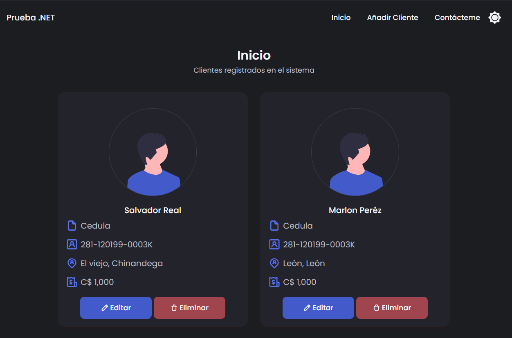
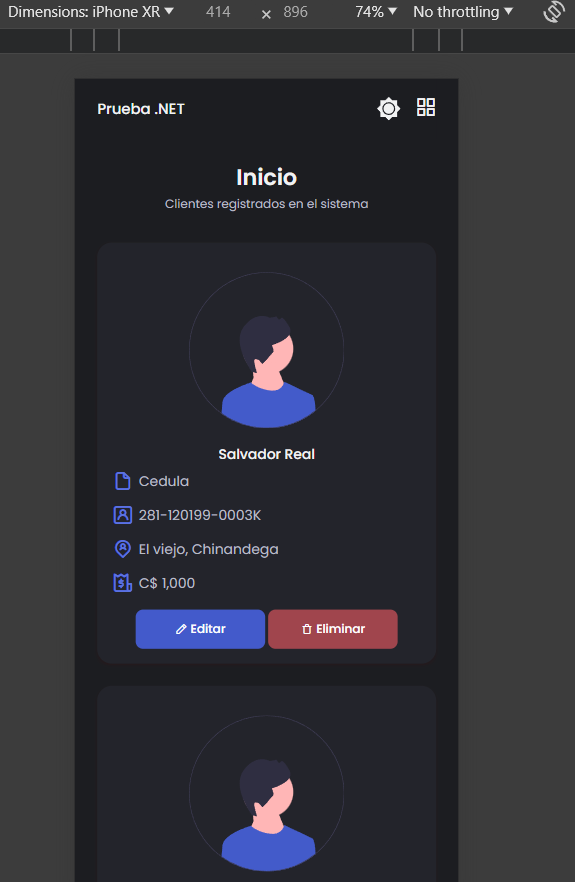
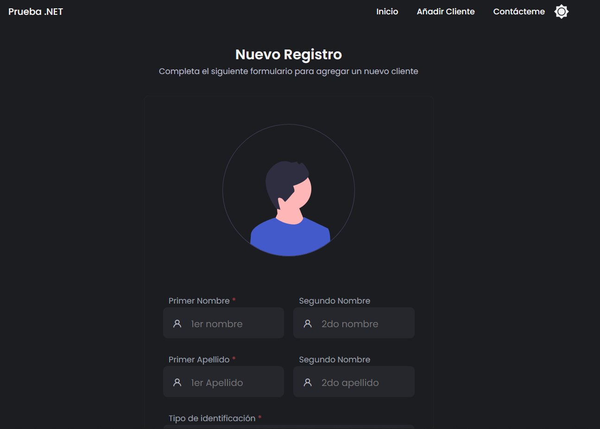

[tags]: https://github.com/srealmoreno/prueba-bdf/tags
[wiki]: https://github.com/srealmoreno/prueba-bdf/wiki
[contributors]: https://github.com/srealmoreno/prueba-bdf/graphs/contributors

# Prueba BDF

Pequeña prueba fullstack para aplicar al puesto de
analista de sistema en BDF realizada en ASP.NET Web Forms (Responsive) y WCF Services.
con estilos **css** y **js** propios, sin librerías de terceros.

## 🚀 Comenzando

Estas instrucciones te permitirán obtener una copia del proyecto en funcionamiento en tu máquina local para propósitos de desarrollo y pruebas. Consulta [Despliegue](#-despliegue) para conocer como desplegar el proyecto.

### 📋 Pre-requisitos

Para poder ejecutar el proyecto necesitas tener instalado:

- [Git](https://git-scm.com/downloads)
- [Visual Studio](https://visualstudio.microsoft.com/es/downloads/)
- [Docker](https://www.docker.com/products/docker-desktop) (Opcional)
- [Sql Server](https://www.microsoft.com/es-es/sql-server/sql-server-downloads) (En caso de no usar Docker)

### 🔧 Instalando

Clona el repositorio en tu máquina local y accede a la carpeta `src`

```bash
git clone https://github.com/srealmoreno/prueba-bdf
```

## 📦 Descripción de la prueba

1. Transact SQL
   Ver los scripts en la carpeta [`initdb`](../src/initdb/)

   - **docker-compose.yml**: Construye un contenedor con SQL Server
     e importa los scripts de la carpeta `initdb` para inicializar la base de datos.

2. WCF Services
   El backend fue desarrollado con 4 capas:

   - **01 - Model**: Entidades de la base de datos y vistas de las tablas
   - **02 - Common**: Clases, interfaces y métodos comunes
   - **03 - Repository**: Repositorios de las entidades (Acceso a la base de datos)
   - **04 - Business Logic**: Lógica de negocio
   - **05 - Host**: Servicios WCF

3. ASP.NET Web Forms
   El frontend fue desarrollado **sin librerías de terceros**,
   esta responsivo y se adapta a dispositivos móviles.
   - **Test.Web**: Página principal

## 📦 Despliegue

Para desplegar el proyecto en un servidor local:

### 🐋 Con Docker Desktop

He utilizado Docker para crear un contenedor con una imagen de SQL Server.
para no tener que instalar SQL Server en mi máquina local.

Puedes hechar un vistazo al archivo `docker-compose.yml` para ver la configuración

1. Abre la solución en Visual Studio
2. Actualiza paquetes de NuGet
   En la consola de administrador de paquetes de NuGet ejecuta:
   
   ```bash	
   Update-Package Microsoft.CodeDom.Providers.DotNetCompilerPlatform -r
   ```
3. Establece `docker-compose`, `Test.Api` y `Test.Web` como 
   [múltiples proyectos de inicio](https://learn.microsoft.com/en-us/visualstudio/ide/how-to-set-multiple-startup-projects?view=vs-2022)

> Probablemente fallará la conexión a la base de datos, esto sucede porque
> el contenedor de SQL server no ha finalizado su inicialización.
>
> En visual studio se abrirá una ventana de salida del docker-compose,
> espera a que finalice y recarga la página o abre docker desktop y verifica
> los logs del contenedor `mssql-server` para ver si ya está listo.

**Importante:** El contenedor utilizará un volumen efímero,
al cerrar el visual studio se perderán los datos de la base de datos,
si quieres persistir los datos, debes modificar el archivo `docker-compose.yml`
y descomenta la linea `mssql-data:/var/opt/mssql`

```yaml
volumes:
  - ./initdb:/docker-entrypoint-initdb.d
  #- mssql-data:/var/opt/mssql
```

### 🐘 Sin Docker

Si no quieres usar Docker, puedes instalar SQL Server en tu máquina local.
Debes ejecutar todos los scripts `.sql` que se encuentran en la carpeta `initdb`
en el orden que se encuentran.

1. Abre la solución en Visual Studio
2. Modifica la cadena de conexión en el archivo `Test.Api/Web.config`
3. Actualiza paquetes de NuGet
   En la consola de administrador de paquetes de NuGet ejecuta:
   
   ```bash	
   Update-Package Microsoft.CodeDom.Providers.DotNetCompilerPlatform -r
   ```
4. Establece `Test.Api` y `Test.Web` como 
   [múltiples proyectos de inicio](https://learn.microsoft.com/en-us/visualstudio/ide/how-to-set-multiple-startup-projects?view=vs-2022)

## 🛠️ Construido con

- [WCFServices](https://docs.microsoft.com/en-us/dotnet/framework/wcf/) - Servicios WCF (Backend)
- [Entity Framework](https://docs.microsoft.com/en-us/ef/) - ORM
- [ASP.NET Web Forms](https://dotnet.microsoft.com/apps/aspnet/web-forms) - Frontend (Sin librerías **css y js** de terceros)
- [SQL Server](https://www.microsoft.com/es-es/sql-server/sql-server-downloads) - Base de datos
- [Docker](https://www.docker.com/products/docker-desktop) - Contenedor de SQL Server (Opcional)

## 🖇️ Colaborando

Por favor lee [CONTRIBUTING](CONTRIBUTING.md) para detalles de nuestro código de conducta, y el proceso para enviarnos pull requests.

## 📌 Veersionado

Usamos [SemVer](http://semver.org/) para el versionado. Para las versiones
disponibles, mira los [tags en este repositorio][tags].

## ✒️ Autores

- **Srealmoreno** - _Trabajo Inicial_ - [srealmoreno](https://github.com/srealmoreno)

Ver también la lista de todos los [contribuyentes][contributors] que han participado en este proyecto.

## 📄 Licencia

Este proyecto está bajo la Licencia MIT - mira el archivo [LICENSE.md](../LICENSE.md)
para detalles

## 🎁 Reconocimientos

- Gracias a BDF por la oportunidad de participar en su proceso de selección

## 📈 Visualizaciones

1. Visualización de clientes:
   
   > En esta vista se pueden ver los clientes registrados en la base de datos,

   
   > La vista es responsive, se adapta a dispositivos móviles.

2. Agregar cliente:
   
